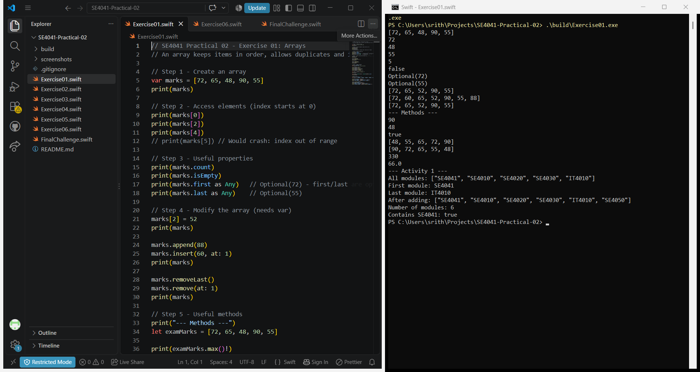
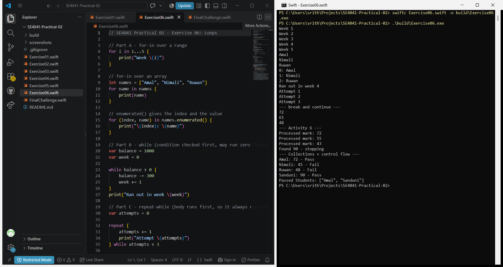
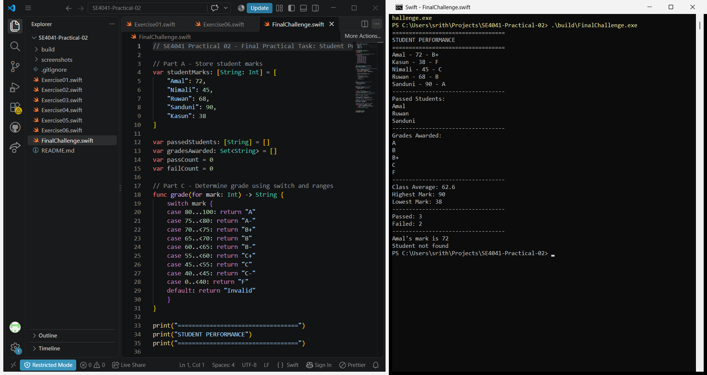

# SE4041 – Practical 02: Collections & Control Flow in Swift

| | |
|---|---|
| **Student Name** | Abisheak S |
| **Student ID** | IT21244384 |
| **Environment** | Swift toolchain for Windows, run with `swift <file>.swift` |

## Files

| File | Content |
|---|---|
| `Exercise01.swift` | Arrays, Activity 1 |
| `Exercise02.swift` | Sets and set operations, Activity 2 |
| `Exercise03.swift` | Dictionaries, Activity 3 (Phone Book) |
| `Exercise04.swift` | if / else if / else, Activity 4 |
| `Exercise05.swift` | switch and ranges, Activity 5 |
| `Exercise06.swift` | for-in, while, repeat-while, break/continue, Activity 6, Knowledge Check |
| `FinalChallenge.swift` | Student Performance Manager + Additional Challenge |

## My Practical Evidence

